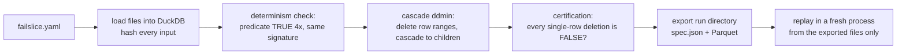

# FailSlice

**Shrink a multi-table dataset to the handful of rows that still trigger your data bug,
keep foreign keys intact, and prove it with an independent replay.**

[English](#english) · [فارسی](#فارسی)

> **Status: pre-alpha.** The core engine works today through the Python API (load, check,
> reduce, export, replay). The command-line tool, the MCP server for AI agents, and the
> manifest / report / generated pytest artifacts are being built next (see
> [Roadmap](#roadmap)). Not published on PyPI yet; install from source.

<a id="english"></a>

## What it does

A data pipeline breaks on 26,001 rows spread over three tables. Somewhere in there a few
rows cause the problem, but you cannot attach 26k rows to a bug report, and deleting rows
by hand breaks the foreign keys between the tables.

FailSlice takes:

- your tables (CSV, Parquet, or tables inside a `.duckdb` file),
- the foreign keys between them,
- a **failure predicate**: a DuckDB SQL query that says "the bug is present",

and returns a much smaller set of rows for which the predicate is still TRUE, with no
new dangling references, written to a run directory and replayed in a fresh process.

For the bundled [quickstart example](examples/quickstart/) (a duplicated order that
inflates joined revenue) the result is:

| table | before | after |
|---|---:|---:|
| customers | 1,000 | 1 |
| orders | 5,001 | 2 (the duplicated order, twice) |
| lines | 20,000 | 1 |

labelled `1-minimal (verified)` and replay status `verified`. These numbers are produced
by the example and checked by [`tests/test_examples.py`](tests/test_examples.py).

## How it works



1. **Load.** Every table is loaded into an in-memory DuckDB database. Each input file is
   hashed before and after loading, so the recorded identity matches the loaded rows.
2. **Check.** The predicate is validated (one read-only `SELECT`, no file access, no
   volatile functions) and must be TRUE on the full data four times with the same result
   signature. Rows that already reference a missing parent ("input orphans") are recorded.
3. **Reduce.** A delta-debugging (ddmin) search removes ranges of rows table by table,
   parents first. Deleting a parent row also removes the child rows that would lose
   their parent, so every configuration the predicate sees is referentially intact. A
   configuration is kept only if the predicate is freshly evaluated TRUE on it.
4. **Certify (optional, on by default).** Tries deleting each remaining row on its own.
   Only if every such deletion makes the predicate FALSE is the result labelled
   `1-minimal (verified)`.
5. **Export and replay.** The kept rows are written as Parquet plus a typed `spec.json`;
   a new Python process rebuilds the database from those files alone, checks the foreign
   keys and runs the predicate again.

The ideas are established ones (delta debugging, database subsetting); FailSlice combines
them for predicate-guided, multi-table, FK-consistent row reduction on local files.

## Quickstart

Requirements: Python 3.11+ and [uv](https://docs.astral.sh/uv/).

```bash
git clone https://github.com/sdmhdn/failslice.git
cd failslice
uv sync
cd examples/quickstart
uv run python make_data.py      # writes data/generated/*.csv
uv run python run.py
```

`failslice.yaml`:

```yaml
version: 1
tables:
  customers: { path: data/generated/customers.csv, primary_key: id }
  orders:    { path: data/generated/orders.csv, primary_key: order_id }
  lines:     { path: data/generated/lines.csv }
foreign_keys:
  - orders.customer_id -> customers.id
  - lines.order_id -> orders.order_id
predicate:
  # The bug: order 4242 was loaded twice, so joining lines to orders double-counts.
  sql: |
    SELECT (SELECT sum(l.amount) FROM lines l JOIN orders o USING (order_id))
        <> (SELECT sum(amount) FROM lines)
settings: { seed: 0, max_evals: 5000, wall_clock_s: 300 }
```

`run.py`:

```python
import failslice


def main() -> None:
    project = failslice.load_project("failslice.yaml")

    report = failslice.check(project)  # FK orphans + determinism of the predicate
    print("check ok:", report.ok)

    result = failslice.reduce(project, isolate=True)
    print(result.status, "|", result.minimality_label, "|", result.verification.status)
    print(result.stats.sizes_before, "->", result.stats.sizes_after)
    print("run directory:", result.run_dir)


if __name__ == "__main__":  # required: isolate=True starts a child process
    main()
```

`isolate=True` runs the reduction in a supervised child process with hard deadlines;
like any `multiprocessing` code it needs the `if __name__ == "__main__":` guard.

## Writing the predicate

The predicate is a single read-only DuckDB `SELECT` (CTEs allowed) over the configured
table names. Pick one of three forms:

```yaml
# 1. Boolean: one row, one BOOLEAN column; TRUE means "the bug is present".
predicate:
  sql: SELECT count(*) > 0 FROM orders WHERE customer_id IS NULL

# 2. Expectation: the bug is present when the result differs from the expected one
#    (or, with mode: equals, when it equals it).
predicate:
  expect:
    query: SELECT coalesce(sum(amount), 0) - coalesce(sum(paid), 0) FROM lines
    expected: 0               # or expected_file: expected.csv
    mode: differs             # differs | equals
    ordered: false            # compare as a bag of rows by default
    float_tolerance: 0.001    # optional absolute tolerance

# 3. Error: the bug is present when the query raises a matching DuckDB error.
predicate:
  raises:
    query: SELECT sum(CAST(raw AS INTEGER)) FROM readings
    match: Could not convert string     # regular expression (re.search)
    error_class: ConversionException    # optional
```

Every evaluation is classified as `TRUE`, `FALSE`, `ERROR` (malformed result or an error
the predicate does not match) or `TIMEOUT`. Only `TRUE` counts as "still failing": every
kept configuration satisfies *your predicate*, so make the predicate as specific as the
bug (a broad `raises.match` regex can let the search keep a different error that
matches it).

Tips:

- With `mode: differs`, an emptied table usually "differs" too. Prefer self-consistent
  queries whose correct value does not depend on how much data there is (as above).
- Expectation results compare exactly: integers and decimals are never rounded through
  floats, booleans never equal numbers, and NULL equals NULL.

## Configuration

| key | meaning |
|---|---|
| `tables.<name>.path` | CSV / Parquet / `.duckdb` file, relative to the config file; must stay inside the allowed root (default: the config's directory) |
| `tables.<name>.format` | `csv`, `parquet` or `duckdb` (otherwise inferred from the extension) |
| `tables.<name>.source_table` | table name inside a `.duckdb` file (default: the configured name) |
| `tables.<name>.primary_key` | informational only; never enforced, since duplicate keys are often the bug |
| `foreign_keys` | `child.column -> parent.column`, single column, must form an acyclic graph |
| `settings.seed` | seed of the deletion order (same seed, same result) |
| `settings.max_evals` | maximum number of predicate executions (cache hits are free) |
| `settings.wall_clock_s` | total time budget, including export and replay |
| `settings.eval_timeout_s` | time limit for one predicate execution |
| `settings.minimality` | run the certification pass (default `true`) |
| `settings.allow_nondeterministic` | reduce even if the determinism check finds an unstable predicate (no minimality claim) |
| `settings.threads` | DuckDB threads (default 1, for reproducibility) |

## What you get

Each run writes a directory (default `.failslice/runs/<run-id>/`):

| file | content |
|---|---|
| `tables/<t>.parquet` | the kept rows, in original order |
| `spec.json` | typed, versioned description of the reproducer: schemas, FKs, predicate, input file hashes, replay settings |
| `rowmap.parquet` | output row -> original row number in the input file |
| `orphans.parquet` | input orphans that survive (allowed dangling references) |
| `expected/expected.parquet` | snapshot of the expectation file, if one is used |
| `result.json` | status, minimality label, statistics, replay result |
| `checkpoint.json` | last confirmed configuration (used to recover a killed run) |

The public API: `load_project`, `check`, `reduce`, `verify` (replay an existing run
directory), `validate_predicate`, plus the result types `CheckReport`, `ReductionResult`
and `VerificationReport`.

## Guarantees and limits

What FailSlice guarantees (each point is enforced in code and covered by tests):

- **Only observed failures are kept.** A configuration is accepted only after a fresh
  evaluation returned TRUE. The cache stores negative results only, as search hints.
- **No new dangling references.** Every configuration the predicate sees, and the
  exported result, keeps all foreign keys that held in the input. Input orphans are
  kept as recorded exemptions, never "repaired".
- **Independent replay.** The result is replayed in a fresh process from the exported
  files alone. `verified` means: predicate TRUE and integrity holds there.
- **Honest labels.** The result is called `1-minimal (verified)` only when the
  certification pass completed and every single-row deletion was FALSE; otherwise it is
  "reduced". FailSlice never claims a globally smallest result and never claims to find
  the root cause.
- **Determinism.** The same inputs, settings and seed give the same result (for runs not
  stopped by time).
- **Sandboxed predicates.** Only a single `SELECT` over the configured tables is
  accepted; file-reading and volatile functions are rejected, input paths must stay
  inside the allowed root, and DuckDB's external file access is switched off after
  loading.

Current limits:

- Single-column foreign keys only; no cycles (including self-references).
- All data is loaded into memory (in-process DuckDB).
- Without `isolate=True`, timeouts are cooperative: they interrupt the SQL query, but
  not Python-side work such as a slow regular expression.
- The predicate must be deterministic; nondeterministic ones are refused by default.

## Roadmap

- **Phase 3:** CSV export, manifest, Markdown report, generated pytest regression test,
  `failslice` CLI (`init`, `check`, `reduce`, `verify`, `export-test`, `explain`).
- **Phase 4:** MCP server `failslice-mcp`, so AI agents can run the same loop.
- **Phase 5:** examples and generated benchmarks.
- **Phase 6:** polish and first release.

Design details: [`docs/design.md`](docs/design.md); decisions:
[`docs/decisions/`](docs/decisions/).

## Development

```bash
uv sync
uv run ruff check . && uv run ruff format --check .
uv run mypy
uv run pytest --cov
```

The test suite includes Hypothesis property tests on random multi-table schemas and a
brute-force oracle for small inputs.

## License

MIT, see [LICENSE](LICENSE). To cite FailSlice, see [CITATION.cff](CITATION.cff).

## Author

Created and maintained by Saeed Mahdian ([@sdmhdn](https://github.com/sdmhdn),
<saeed.mahdian@gmail.com>).

---

<a id="فارسی"></a>

<div dir="rtl" lang="fa">

## فارسی

**فیل‌اسلایس (FailSlice) یک مجموعه‌دادهٔ چندجدولی را تا چند ردیفی کوچک می‌کند که هنوز باگ داده را نشان می‌دهند، کلیدهای خارجی را سالم نگه می‌دارد و نتیجه را با اجرای مستقل دوباره تأیید می‌کند.**

> وضعیت: پیش‌آلفا. هستهٔ اصلی امروز از طریق API پایتون کار می‌کند (بارگذاری، بررسی، کوچک‌سازی، خروجی و اجرای مجدد). ابزار خط فرمان، سرور MCP برای عامل‌های هوش مصنوعی و خروجی‌های گزارش و تست pytest مراحل بعدی هستند. هنوز روی PyPI منتشر نشده و باید از سورس نصب شود.

### چه کاری انجام می‌دهد؟

فرض کنید یک پایپ‌لاین داده روی ۲۶٬۰۰۱ ردیف در سه جدول خراب می‌شود. چند ردیف در این میان مقصرند، اما نمی‌شود ۲۶ هزار ردیف را به گزارش باگ پیوست کرد، و حذف دستی ردیف‌ها هم کلیدهای خارجی بین جدول‌ها را می‌شکند.

ورودی‌های فیل‌اسلایس این‌ها هستند:

- جدول‌های شما (فایل CSV، فایل Parquet یا جدول‌های داخل یک فایل `.duckdb`)
- کلیدهای خارجی بین جدول‌ها
- یک **گزارهٔ خطا** (failure predicate): کوئری SQL در DuckDB که می‌گوید «باگ وجود دارد»

و خروجی آن مجموعهٔ بسیار کوچک‌تری از ردیف‌هاست که گزاره روی آن هنوز TRUE است، هیچ ارجاع معلق تازه‌ای ندارد، در یک پوشهٔ اجرا ذخیره می‌شود و در یک پردازهٔ تازه دوباره اجرا و تأیید می‌شود.

برای نمونهٔ همراه پروژه (پوشهٔ `examples/quickstart`، یک سفارش تکراری که جمع درآمد را در join زیاد نشان می‌دهد) نتیجه چنین است:

- جدول مشتری‌ها (`customers`): از ۱٬۰۰۰ ردیف به ۱ ردیف
- جدول سفارش‌ها (`orders`): از ۵٬۰۰۱ ردیف به ۲ ردیف (همان سفارش تکراری، دو بار)
- جدول اقلام سفارش (`lines`): از ۲۰٬۰۰۰ ردیف به ۱ ردیف

برچسب نتیجه `1-minimal (verified)` و وضعیت اجرای مجدد `verified` است. این اعداد را خود نمونه تولید می‌کند و تست `tests/test_examples.py` آن‌ها را بررسی می‌کند.

### چطور کار می‌کند؟

1. **بارگذاری:** همهٔ جدول‌ها در یک پایگاه DuckDB درون حافظه بارگذاری می‌شوند. از هر فایل ورودی قبل و بعد از بارگذاری هش گرفته می‌شود تا شناسهٔ ثبت‌شده دقیقاً با ردیف‌های بارگذاری‌شده بخواند.
2. **بررسی:** گزاره اعتبارسنجی می‌شود (فقط یک `SELECT` فقط‌خواندنی، بدون دسترسی به فایل و بدون تابع‌های ناپایدار) و باید روی کل داده چهار بار با امضای یکسان TRUE شود. ردیف‌هایی که از اول به والدِ ناموجود اشاره می‌کنند («یتیم‌های ورودی») ثبت می‌شوند.
3. **کوچک‌سازی:** جست‌وجوی delta debugging (ddmin) بازه‌هایی از ردیف‌ها را جدول‌به‌جدول و از والدها به فرزندها حذف می‌کند. با حذف یک ردیف والد، ردیف‌های فرزندی که والدشان را از دست می‌دهند هم حذف می‌شوند؛ بنابراین هر پیکربندی‌ای که گزاره می‌بیند از نظر ارجاعی سالم است. یک پیکربندی فقط وقتی پذیرفته می‌شود که گزاره همان لحظه روی آن TRUE شده باشد.
4. **گواهی‌دادن** (اختیاری و به‌طور پیش‌فرض فعال): حذف تک‌تک ردیف‌های باقی‌مانده امتحان می‌شود. فقط اگر حذف هر کدام گزاره را FALSE کند، نتیجه برچسب `1-minimal (verified)` می‌گیرد.
5. **خروجی و اجرای مجدد:** ردیف‌های نگه‌داشته‌شده به‌صورت Parquet همراه با یک فایل `spec.json` نوع‌دار نوشته می‌شوند. یک پردازهٔ پایتون تازه پایگاه داده را فقط از همین فایل‌ها می‌سازد، کلیدهای خارجی را بررسی می‌کند و گزاره را دوباره اجرا می‌کند.

ایده‌ها تازه نیستند (delta debugging و زیرمجموعه‌سازی پایگاه داده)؛ فیل‌اسلایس آن‌ها را برای کوچک‌سازی چندجدولی، هدایت‌شده با گزاره و سازگار با کلید خارجی روی فایل‌های محلی کنار هم می‌گذارد.

### شروع سریع

پیش‌نیازها: پایتون ۳٫۱۱ یا بالاتر و ابزار `uv`.

1. مخزن را کلون کنید: `git clone https://github.com/sdmhdn/failslice.git`
2. در پوشهٔ پروژه وابستگی‌ها را نصب کنید: `uv sync`
3. به پوشهٔ `examples/quickstart` بروید و داده را بسازید: `uv run python make_data.py`
4. نمونه را اجرا کنید: `uv run python run.py`

متن کامل فایل پیکربندی `failslice.yaml` و اسکریپت `run.py` در بخش انگلیسی بالا آمده است. نکته: با `isolate=True` کوچک‌سازی در یک پردازهٔ فرزند با مهلت سخت اجرا می‌شود، پس مثل هر کد `multiprocessing` به محافظ `if __name__ == "__main__":` نیاز دارد.

### نوشتن گزاره

گزاره یک `SELECT` فقط‌خواندنی در DuckDB است (CTE مجاز است) که فقط از نام جدول‌های تعریف‌شده استفاده می‌کند. سه شکل دارد:

1. **شکل بولی** (کلید `sql`): نتیجه یک ردیف و یک ستون BOOLEAN است و TRUE یعنی «باگ وجود دارد».
2. **شکل انتظار** (کلید `expect`): باگ وقتی وجود دارد که نتیجهٔ کوئری با مقدار مورد انتظار فرق کند (یا با `mode: equals` وقتی برابر باشد). مقدار مورد انتظار یا درون‌خطی است (`expected`) یا از فایل (`expected_file`). مقایسه به‌صورت پیش‌فرض مستقل از ترتیب ردیف‌هاست و تلورانس عددی اختیاری دارد.
3. **شکل خطا** (کلید `raises`): باگ وقتی وجود دارد که کوئری خطایی از DuckDB بدهد که پیامش با عبارت منظم `match` و (در صورت تعیین) کلاسش با `error_class` بخواند.

هر اجرای گزاره یکی از این چهار نتیجه را می‌گیرد: `TRUE`، `FALSE`، `ERROR` (نتیجهٔ نادرست یا خطایی که با گزاره نمی‌خواند) یا `TIMEOUT`. فقط `TRUE` یعنی «هنوز خراب است»: هر پیکربندی نگه‌داشته‌شده *گزارهٔ شما* را برقرار می‌کند، پس گزاره را به اندازهٔ خود باگ دقیق بنویسید (مثلاً عبارت منظم خیلی کلی در `raises.match` ممکن است اجازه دهد جست‌وجو به خطای دیگری که با آن می‌خواند برسد).

چند توصیه:

- با `mode: differs` جدول خالی‌شده هم معمولاً «متفاوت» است؛ بهتر است کوئری‌هایی بنویسید که مقدار درستشان به حجم داده بستگی ندارد (مثلاً اختلاف دو جمع که باید صفر باشد).
- مقایسهٔ نتیجه‌ها دقیق است: عدد صحیح و اعشاری هیچ‌وقت از مسیر float گرد نمی‌شوند، مقدار بولی با عدد برابر نیست و NULL با NULL برابر است.

### خروجی‌ها

هر اجرا یک پوشه می‌سازد (به‌طور پیش‌فرض `.failslice/runs/<run-id>/`) که این فایل‌ها را دارد:

- پوشهٔ `tables/`: ردیف‌های نگه‌داشته‌شدهٔ هر جدول به‌صورت Parquet، به ترتیب اصلی
- فایل `spec.json`: توصیف نوع‌دار و نسخه‌دار بازتولید (اسکیماها، کلیدهای خارجی، گزاره، هش فایل‌های ورودی، تنظیمات اجرای مجدد)
- فایل `rowmap.parquet`: نگاشت هر ردیف خروجی به شمارهٔ ردیفش در فایل ورودی
- فایل `orphans.parquet`: یتیم‌های ورودی که در خروجی مانده‌اند (ارجاع‌های معلق مجاز)
- فایل `expected/expected.parquet`: نسخهٔ ثابت فایل انتظار، اگر استفاده شده باشد
- فایل `result.json`: وضعیت، برچسب کمینگی، آمار و نتیجهٔ اجرای مجدد
- فایل `checkpoint.json`: آخرین پیکربندی تأییدشده (برای بازیابی اجرایی که متوقف شده)

### تضمین‌ها و محدودیت‌ها

تضمین‌های فیل‌اسلایس (هر کدام در کد اعمال و با تست پوشش داده شده است):

- **فقط خطای مشاهده‌شده نگه داشته می‌شود:** پیکربندی فقط پس از یک ارزیابی تازه با نتیجهٔ TRUE پذیرفته می‌شود. حافظهٔ نهان فقط نتیجه‌های منفی را به‌عنوان راهنمای جست‌وجو نگه می‌دارد.
- **هیچ ارجاع معلق تازه‌ای ساخته نمی‌شود:** هر پیکربندی و خروجی نهایی همهٔ کلیدهای خارجی‌ای را که در ورودی برقرار بوده‌اند حفظ می‌کند. یتیم‌های ورودی به‌عنوان استثنای ثبت‌شده باقی می‌مانند و «تعمیر» نمی‌شوند.
- **اجرای مجدد مستقل:** نتیجه در یک پردازهٔ تازه و فقط از فایل‌های خروجی دوباره اجرا می‌شود. وضعیت `verified` یعنی آنجا هم گزاره TRUE بوده و یکپارچگی برقرار است.
- **برچسب‌های صادقانه:** برچسب `1-minimal (verified)` فقط وقتی داده می‌شود که مرحلهٔ گواهی کامل شده و حذف هر ردیف تکی FALSE بوده باشد؛ در غیر این صورت نتیجه فقط «کوچک‌شده» است. فیل‌اسلایس هرگز ادعای کوچک‌ترین نتیجهٔ ممکن یا یافتن علت ریشه‌ای را نمی‌کند.
- **قطعیت:** ورودی، تنظیمات و seed یکسان نتیجهٔ یکسان می‌دهند (برای اجراهایی که با محدودیت زمانی متوقف نشده‌اند).
- **گزارهٔ محصور:** فقط یک `SELECT` روی جدول‌های تعریف‌شده پذیرفته می‌شود؛ تابع‌های خواندن فایل و تابع‌های ناپایدار رد می‌شوند، مسیرهای ورودی باید داخل ریشهٔ مجاز بمانند و دسترسی DuckDB به فایل‌های بیرونی پس از بارگذاری خاموش می‌شود.

محدودیت‌های فعلی:

- فقط کلید خارجی تک‌ستونی پشتیبانی می‌شود و چرخه (از جمله ارجاع جدول به خودش) مجاز نیست.
- همهٔ داده در حافظه بارگذاری می‌شود.
- بدون `isolate=True` مهلت زمانی همکارانه است: کوئری SQL را قطع می‌کند اما کار سمت پایتون (مثل یک عبارت منظم کند) را نه.
- گزاره باید قطعی باشد؛ گزاره‌های غیرقطعی به‌طور پیش‌فرض رد می‌شوند.

### نقشهٔ راه

- **مرحلهٔ ۳:** خروجی CSV، مانیفست، گزارش Markdown، تولید خودکار تست رگرسیون pytest و ابزار خط فرمان `failslice`
- **مرحلهٔ ۴:** سرور MCP به نام `failslice-mcp` تا عامل‌های هوش مصنوعی هم بتوانند همین چرخه را اجرا کنند
- **مرحلهٔ ۵:** نمونه‌ها و بنچمارک‌های تولیدشده
- **مرحلهٔ ۶:** آماده‌سازی و انتشار نسخهٔ اول

جزئیات طراحی در فایل `docs/design.md` و تصمیم‌های معماری در پوشهٔ `docs/decisions/` آمده است.

### مجوز و سازنده

مجوز پروژه MIT است (فایل `LICENSE`). سازنده و نگه‌دارنده: سعید مهدیان (در گیت‌هاب `sdmhdn`).

</div>
