# FailSlice

**Shrink a multi-table dataset to the handful of rows that still trigger your data bug,
keep foreign keys intact, prove it with an independent replay, and get a ready-to-run
pytest regression test.**

[](https://github.com/sdmhdn/failslice/actions/workflows/ci.yml)

[English](#english) · [فارسی](#فارسی) · [Documentation](docs/index.md)

> **Status: pre-alpha.** The engine, the `failslice` command line, the run report and
> manifest, the generated pytest test and the `failslice-mcp` server for AI agents work
> today. Not published on PyPI yet; install from source.

<a id="english"></a>

## Why FailSlice

A pipeline produces a wrong number on 26,001 rows spread over three tables. Logs tell you
*which* step failed; data-quality checks flag rows that break a *row-level* rule. But the
hardest data bugs come from a *combination* of rows across tables (a duplicated key plus
a join that double-counts, a NULL inside `NOT IN`, a timestamp tie in "latest record per
key"), where no single row is wrong. You cannot attach 26k rows to a bug report, and
deleting rows by hand breaks the foreign keys and changes the bug.

FailSlice answers: *what is the smallest slice of these tables that still makes this
failure happen?* The ideas are not new (delta debugging to shrink failing inputs, database
subsetting to keep foreign keys intact); what FailSlice adds is their combination with
checked claims:

- the search is **guided by your failure predicate**, a DuckDB SQL query that says "the
  bug is present";
- every configuration the predicate sees is **referentially intact**;
- the result is **replayed in a fresh process** from the exported files only, and called
  `1-minimal (verified)` only when that check really ran;
- you get a **self-contained pytest test** (only `pytest` and `duckdb` needed) that
  documents the bug now and guards against its return after the fix;
- an **MCP server** (`failslice-mcp`), so an AI agent can go from "here are my files" to
  "here is a failing test" without loading millions of rows into its context.

FailSlice isolates rows; it does not determine the root cause.

## Example

The bundled [quickstart](examples/quickstart/): order 4242 was loaded twice, so joining
order lines to orders double-counts revenue.

| table | before | after |
|---|---:|---:|
| customers | 1,000 | 1 |
| orders | 5,001 | 2 (the duplicated order, twice) |
| lines | 20,000 | 1 |

Result `1-minimal (verified)`, replay `verified`; these numbers come from the example and
are checked by [`tests/test_examples.py`](tests/test_examples.py).

## More examples and benchmarks

Four more scenarios, each runnable with one command and each needing a *combination* of
rows across tables:

- [TPC-H fan-out](examples/tpch_fanout/): a late-arriving duplicate order inflates revenue
  by region (TPC-H data from DuckDB's `tpch` extension).
- [NULL in `NOT IN`](examples/null_not_in/): one NULL in a suppression list empties a
  mailing.
- [Date-parsing crash](examples/date_parse_crash/): a depot switches date format and the
  staging query fails (`raises` predicate).
- [Latest record per key](examples/latest_tie/): a timestamp tie across two event streams
  gives an account two "current" rows.

<!-- benchmarks:start -->
<!-- Generated by `uv run python benchmarks/run.py` from benchmarks/results.json; do not edit by hand. -->

| scenario | input rows | output rows | kept | evaluations | wall time | minimality |
|---|---:|---:|---:|---:|---:|---|
| [quickstart](examples/quickstart/) | 26,001 | 4 | 0.0154% | 37 | 1.3 s | 1-minimal (verified) |
| [tpch_fanout](examples/tpch_fanout/) | 76,706 | 6 | 0.0078% | 57 | 2.1 s | 1-minimal (verified) |
| [tpch_fanout (sf 0.1)](examples/tpch_fanout/) | 765,603 | 6 | 0.0008% | 63 | 4.1 s | 1-minimal (verified) |
| [null_not_in](examples/null_not_in/) | 6,101 | 3 | 0.0492% | 21 | 1.0 s | 1-minimal (verified) |
| [date_parse_crash](examples/date_parse_crash/) | 30,007 | 2 | 0.0067% | 31 | 1.0 s | 1-minimal (verified) |
| [latest_tie](examples/latest_tie/) | 11,000 | 3 | 0.0273% | 37 | 1.1 s | 1-minimal (verified) |

Measured 2026-11-18 on one machine (12th Gen Intel(R) Core(TM) i7-1260P, 16 logical CPUs, 7.5 GiB RAM; Linux 6.6.87.2-microsoft-standard-WSL2; Python 3.12.15, DuckDB 2.0.0, FailSlice 0.0.1.dev0 at bc83451). Wall time is the median of 3 runs of `reduce(isolate=True)` including the replay and artifacts, without data generation; it depends on the machine. [Method](benchmarks/README.md).
<!-- benchmarks:end -->

## Quickstart

Requirements: Python 3.11+ and [uv](https://docs.astral.sh/uv/).

```bash
git clone https://github.com/sdmhdn/failslice.git
cd failslice
uv sync
cd examples/quickstart
uv run python make_data.py      # writes data/generated/*.csv
uv run failslice check          # is the predicate TRUE on the full data, every time?
uv run failslice reduce
```

```text
1-minimal (verified): 26,001 -> 4 rows (0.02%); replay verified
run directory: .../examples/quickstart/.failslice/runs/<run-id>
  report: .../report.md
  test:   pytest .../pytest
```

Then `failslice explain <run dir>` shows what is special about the surviving rows (here:
order 4242 has two parent rows), `uv run pytest <run dir>/pytest` runs the generated test,
and `failslice export-test <run dir> --out tests/data_bug_4242` copies it into your repo.

For your own data, `failslice init path/to/folder` writes a starting `failslice.yaml` with
every table and with key **suggestions**, commented out for you to review; then you write
the predicate. The quickstart's [`failslice.yaml`](examples/quickstart/failslice.yaml)
shows a complete config.

## How it works

```mermaid
flowchart LR
    CFG[failslice.yaml] --> LOAD[load files into DuckDB<br/>hash every input]
    LOAD --> CHECK[determinism check:<br/>predicate TRUE 4x, same signature]
    CHECK --> RED[cascade ddmin:<br/>delete row ranges, cascade to children]
    RED --> CERT[certification:<br/>every single-row deletion is FALSE?]
    CERT --> EXP[export run directory<br/>spec.json + Parquet]
    EXP --> VER[replay in a fresh process<br/>from the exported files only]
    VER --> ART[report.md, manifest.json,<br/>CSV, pytest bundle]
```



Rows are removed in ranges, table by table, parents first; removing a parent also removes
the child rows that would lose their parent. A candidate is kept only if the predicate is
freshly evaluated TRUE on it. Details: [foreign keys and minimality](docs/foreign-keys.md).

## Guarantees and limits

Each guarantee is enforced in code and covered by tests:

- a configuration is kept only after a fresh TRUE evaluation (the cache holds negative
  results only);
- no new dangling references, ever; input orphans are kept as recorded exemptions;
- independent replay from the exported files; `verified` means predicate TRUE and
  integrity intact there;
- `1-minimal (verified)` only when certification completed, the replay is verified and the
  export was lossless; otherwise "reduced". Never a claim of the smallest possible
  result or of a root cause; `explain` reports observations; `init` makes suggestions;
- same inputs, settings and seed give the same result (for runs not stopped by time);
- predicates are a single sandboxed `SELECT`; paths stay inside an allowed root; DuckDB's
  external file access is switched off after loading.

Limits: single-column, acyclic foreign keys; data loaded into memory; in-process runs have
cooperative timeouts; the predicate must be deterministic.

## Documentation

| | |
|---|---|
| [Overview](docs/index.md) | what FailSlice adds, and the map of the docs |
| [Configuration](docs/configuration.md) | `failslice.yaml`, settings, `init` |
| [Predicates](docs/predicates.md) | the three forms, outcomes, comparison rules |
| [Foreign keys and minimality](docs/foreign-keys.md) | semantics, orphans, cascade, what 1-minimal means |
| [Command line and Python API](docs/cli.md) | commands, options, exit codes, `--json` |
| [Run artifacts](docs/artifacts.md) | manifest, report, CSV, `explain`, the generated test, replay |
| [MCP server](docs/mcp.md) | `failslice-mcp` for AI agents: client setup, tools, resources |
| [Design](docs/design.md) and [decisions](docs/decisions/) | architecture and its reasoning |
| [راهنمای فارسی](docs/guide-fa.md) | the complete guide in Persian |

## Roadmap

- **Phase 3 (done):** manifest, report, CSV, generated pytest test, `explain`, `init`, CLI.
- **Phase 4 (done):** MCP server `failslice-mcp`, so AI agents can run the same loop.
- **Phase 5 (done):** four example scenarios and a generated benchmark table.
- **Phase 6:** polish, CI on three operating systems, first release.

## Development

```bash
uv sync
uv run ruff check . && uv run ruff format --check .
uv run mypy
uv run pytest --cov
```

The test suite includes Hypothesis property tests on random multi-table schemas and a
brute-force oracle for small inputs.

## License

MIT, see [LICENSE](LICENSE). To cite FailSlice, see [CITATION.cff](CITATION.cff).

## Author

Created and maintained by Saeed Mahdian ([@sdmhdn](https://github.com/sdmhdn),
<saeed.mahdian@gmail.com>).

---

<a id="فارسی"></a>

<div dir="rtl" lang="fa">

## فارسی

**فیل‌اسلایس (FailSlice) یک مجموعه‌دادهٔ چندجدولی را تا چند ردیفی کوچک می‌کند که هنوز باگ داده را نشان می‌دهند، کلیدهای خارجی را سالم نگه می‌دارد، نتیجه را با اجرای مستقل تأیید می‌کند و یک تست رگرسیون pytest آماده تحویل می‌دهد.**

> وضعیت: پیش‌آلفا. موتور اصلی، ابزار خط فرمان، گزارش و مانیفست اجرا، تست pytest تولیدی و سرور MCP (`failslice-mcp`) برای عامل‌های هوش مصنوعی امروز کار می‌کنند. هنوز روی PyPI منتشر نشده و باید از سورس نصب شود.

### چرا فیل‌اسلایس؟

فرض کنید یک پایپ‌لاین روی ۲۶٬۰۰۱ ردیف در سه جدول عدد غلط می‌دهد. لاگ‌ها می‌گویند کدام مرحله خراب شد و ابزارهای کیفیت داده ردیف‌هایی را نشان می‌دهند که یک قاعدهٔ ردیفی را نقض می‌کنند. اما سخت‌ترین باگ‌های داده از «ترکیب» چند ردیف در چند جدول ساخته می‌شوند (مثل یک کلید تکراری به‌اضافهٔ یک join که جمع را دوبرابر می‌کند)؛ در این حالت هیچ ردیفی به‌تنهایی غلط نیست. حذف دستی ردیف‌ها هم کلیدهای خارجی را می‌شکند و باگ عوض می‌شود.

فیل‌اسلایس به این پرسش جواب می‌دهد: «کوچک‌ترین تکه از این جدول‌ها که هنوز همین خطا را می‌سازد چیست؟» ایده‌ها تازه نیستند (delta debugging برای کوچک‌کردن ورودی خراب و زیرمجموعه‌سازی پایگاه داده برای حفظ کلیدهای خارجی)؛ کار ویژهٔ فیل‌اسلایس ترکیب این دو با ادعاهای قابل‌بررسی است:

- جست‌وجو با **گزارهٔ خطای شما** هدایت می‌شود؛ یک کوئری SQL که می‌گوید «باگ هست».
- هر پیکربندی‌ای که گزاره می‌بیند **از نظر کلید خارجی سالم** است.
- نتیجه در **پردازه‌ای تازه** و فقط از فایل‌های خروجی دوباره اجرا می‌شود و برچسب `1-minimal (verified)` فقط وقتی داده می‌شود که این بررسی واقعاً انجام شده باشد.
- خروجی یک **تست pytest مستقل** است (فقط با `pytest` و `duckdb`) که امروز باگ را مستند می‌کند و بعد از اصلاح، جلوی برگشتنش را می‌گیرد.
- با **سرور MCP** (`failslice-mcp`)، یک عامل هوش مصنوعی می‌تواند بدون ریختن میلیون‌ها ردیف در context خودش، از «این فایل‌های من» به «این تست شکست‌خورده» برسد.

فیل‌اسلایس ردیف‌ها را جدا می‌کند؛ علت ریشه‌ای را تعیین نمی‌کند.

### شروع سریع

1. مخزن را کلون کنید و در پوشهٔ آن `uv sync` را اجرا کنید.
2. در پوشهٔ `examples/quickstart` داده را بسازید: `uv run python make_data.py`
3. گزاره را بررسی کنید: `uv run failslice check`
4. کوچک‌سازی را اجرا کنید: `uv run failslice reduce`

خروجی این نمونه `1-minimal (verified): 26,001 -> 4 rows (0.02%); replay verified` است: یک مشتری، سفارش تکراری ۴۲۴۲ (دو بار) و یک قلم سفارش.

چهار نمونهٔ واقعی‌تر (از جمله دادهٔ TPC-H) و جدول بنچمارک در بخش انگلیسی بالا و در راهنمای فارسی آمده‌اند.

### راهنمای کامل

همهٔ جزئیات، از نوشتن فایل پیکربندی و گزاره تا خروجی‌ها، تست تولیدی، کدهای خروج و عیب‌یابی، در **[راهنمای فارسی](docs/guide-fa.md)** آمده است.

### سازنده

سازنده و نگه‌دارنده: سعید مهدیان (در گیت‌هاب `sdmhdn`). مجوز پروژه MIT است.

</div>
