# FailSlice

**Shrink a multi-table dataset to the handful of rows that still trigger your data bug,
keep foreign keys intact, prove it with an independent replay, and get a ready-to-run
pytest regression test.**

[](https://github.com/sdmhdn/failslice/actions/workflows/ci.yml)

[English](#english) · [فارسی](#فارسی) · [Documentation](https://github.com/sdmhdn/failslice/blob/main/docs/index.md)

> **Status: alpha (0.1.0).** The engine, the `failslice` command line, the run report and
> manifest, the generated pytest test and the `failslice-mcp` server for AI agents work
> and are tested on Linux, macOS and Windows. The Python API and file formats may still
> change before 1.0.

<!-- mcp-name: io.github.sdmhdn/failslice -->

<a id="english"></a>

## Why FailSlice

A pipeline produces a wrong number on 26,001 rows spread over three tables. Logs tell you
*which* step failed; data-quality checks flag rows that break a *row-level* rule. But the
hardest data bugs come from a *combination* of rows across tables (a duplicated key plus
a join that double-counts, a NULL inside `NOT IN`, a timestamp tie in "latest record per
key"), where no single row is wrong. You cannot attach 26k rows to a bug report, and
deleting rows by hand breaks the foreign keys and changes the bug.

FailSlice answers: *what is the smallest slice of these tables that still makes this
failure happen?* The ideas are not new (delta debugging to shrink failing inputs, database
subsetting to keep foreign keys intact); what FailSlice adds is their combination with
checked claims:

- the search is **guided by your failure predicate**, a DuckDB SQL query that says "the
  bug is present";
- removing rows **never creates a dangling reference**; orphans already in your input are
  kept and recorded;
- the result is **replayed in a fresh process** from the exported files only, and called
  `1-minimal (verified)` only when that check really ran;
- you get a **self-contained pytest test** (only `pytest` and `duckdb` needed) that
  passes while the bug reproduces; after your fix, export it with `--expect passes` to
  guard against the bug's return;
- an **MCP server** (`failslice-mcp`), so an AI agent can go from "here are my files" to
  "here is a failing test" without loading millions of rows into its context.

FailSlice isolates rows; it does not determine the root cause.

## Quickstart (under a minute)

Requirements: [uv](https://docs.astral.sh/uv/) (it fetches Python 3.11+ if needed).

```bash
uvx failslice demo shop          # a 3-table example: order 4242 was loaded twice
cd shop
uvx failslice reduce --out run   # reduce, replay in a fresh process, write the test
uvx --with duckdb pytest -q run/pytest
```

```text
1-minimal (verified): 26,001 -> 4 rows (0.02%); replay verified
run directory: .../shop/run
  report: .../shop/run/report.md
  test:   pytest .../shop/run/pytest
```

The four rows: one customer, order 4242 twice, one order line. Joining lines to orders
double-counts revenue. `uvx failslice explain run` lists what is special about them (order
4242 has two parent rows), and `run/report.md` has the whole story. The generated test
needs only `pytest` and `duckdb`, not FailSlice.

**Your own data:** `uvx failslice init path/to/folder` writes a starting `failslice.yaml`
with every table and with key **suggestions**, commented out for you to review; then you
write the predicate ([predicates](https://github.com/sdmhdn/failslice/blob/main/docs/predicates.md))
and run `failslice check` and `failslice reduce`. The demo's `failslice.yaml` is a complete
example. To install instead of using `uvx`: `pip install failslice` (or `uv tool install
failslice`).

## How it works

```mermaid
flowchart LR
    CFG[failslice.yaml] --> LOAD[load files into DuckDB<br/>hash every input]
    LOAD --> CHECK[determinism check:<br/>predicate TRUE 4x, same signature]
    CHECK --> RED[cascade ddmin:<br/>delete row ranges, cascade to children]
    RED --> CERT[certification:<br/>every single-row deletion is not TRUE?]
    CERT --> EXP[export run directory<br/>spec.json + Parquet]
    EXP --> VER[replay in a fresh process<br/>from the exported files only]
    VER --> ART[report.md, manifest.json,<br/>CSV, pytest bundle]
```



Rows are removed in ranges, table by table, parents first; removing a parent also removes
the child rows that would lose their parent. A candidate is kept only if the predicate is
freshly evaluated TRUE on it. Details: [foreign keys and minimality](https://github.com/sdmhdn/failslice/blob/main/docs/foreign-keys.md).

## Guarantees and limits

Each guarantee is enforced in code and covered by tests:

- a configuration is kept only after a fresh TRUE evaluation (the cache holds negative
  results only);
- no new dangling references, ever; input orphans are kept as recorded exemptions;
- independent replay from the exported files; `verified` means predicate TRUE and
  integrity intact there;
- `1-minimal (verified)` only when certification completed, the replay is verified and the
  export was lossless; otherwise "reduced". Never a claim of the smallest possible
  result or of a root cause; `explain` reports observations; `init` makes suggestions;
- same inputs, settings and seed give the same result, unless a run is stopped by its
  wall-clock budget or an evaluation times out;
- a predicate must be a single read-only `SELECT` (other statements and file-reading
  functions are rejected); paths stay inside an allowed root; DuckDB's external file
  access is switched off after loading.

Limits: single-column, acyclic foreign keys; data loaded into memory; in-process runs have
cooperative timeouts; the predicate must be deterministic.

## For AI agents (MCP)

`failslice-mcp` exposes the loop *inspect, check the predicate, reduce, verify, explain,
export a test* to MCP clients over stdio. The agent passes paths and SQL, never the data.

```bash
claude mcp add failslice -- uvx failslice-mcp --root /absolute/path/to/your/data   # Claude Code
```

Claude Desktop (`claude_desktop_config.json`) and Cursor (`.cursor/mcp.json`) use the same
entry:

```json
{
  "mcpServers": {
    "failslice": {
      "command": "uvx",
      "args": ["failslice-mcp", "--root", "/absolute/path/to/your/data"]
    }
  }
}
```

The server reads files only inside `--root` and writes only under `<root>/.failslice/`.
`uvx failslice-mcp@latest` picks up a newer release. Tools, resources, budgets and tested
clients: [MCP server](https://github.com/sdmhdn/failslice/blob/main/docs/mcp.md).

## Examples and benchmarks

Four more scenarios, each runnable with one command from a checkout and each needing a
*combination* of rows across tables:

- [TPC-H fan-out](https://github.com/sdmhdn/failslice/blob/main/examples/tpch_fanout/): a
  late-arriving duplicate order inflates revenue by region (TPC-H data from DuckDB's
  `tpch` extension).
- [NULL in `NOT IN`](https://github.com/sdmhdn/failslice/blob/main/examples/null_not_in/):
  one NULL in a suppression list empties a mailing.
- [Date-parsing crash](https://github.com/sdmhdn/failslice/blob/main/examples/date_parse_crash/):
  a depot switches date format and the staging query fails (`raises` predicate).
- [Latest record per key](https://github.com/sdmhdn/failslice/blob/main/examples/latest_tie/):
  a timestamp tie across two event streams gives an account two "current" rows.

<!-- benchmarks:start -->
<!-- Generated by `uv run python benchmarks/run.py` from benchmarks/results.json; do not edit by hand. -->

| scenario | input rows | output rows | kept | evaluations | wall time | minimality |
|---|---:|---:|---:|---:|---:|---|
| [quickstart](https://github.com/sdmhdn/failslice/blob/main/examples/quickstart/) | 26,001 | 4 | 0.0154% | 37 | 1.3 s | 1-minimal (verified) |
| [tpch_fanout](https://github.com/sdmhdn/failslice/blob/main/examples/tpch_fanout/) | 76,706 | 6 | 0.0078% | 57 | 2.0 s | 1-minimal (verified) |
| [tpch_fanout (sf 0.1)](https://github.com/sdmhdn/failslice/blob/main/examples/tpch_fanout/) | 765,603 | 6 | 0.0008% | 63 | 3.8 s | 1-minimal (verified) |
| [null_not_in](https://github.com/sdmhdn/failslice/blob/main/examples/null_not_in/) | 6,101 | 3 | 0.0492% | 21 | 0.9 s | 1-minimal (verified) |
| [date_parse_crash](https://github.com/sdmhdn/failslice/blob/main/examples/date_parse_crash/) | 30,007 | 2 | 0.0067% | 31 | 0.9 s | 1-minimal (verified) |
| [latest_tie](https://github.com/sdmhdn/failslice/blob/main/examples/latest_tie/) | 11,000 | 3 | 0.0273% | 37 | 1.1 s | 1-minimal (verified) |

Measured 2026-11-18 on one machine (12th Gen Intel(R) Core(TM) i7-1260P, 16 logical CPUs, 7.5 GiB RAM; Linux 6.6.87.2-microsoft-standard-WSL2; Python 3.12.15, DuckDB 2.0.0, FailSlice 0.0.1.dev0 at 1088226). Wall time is the median of 3 runs of `reduce(isolate=True)` including the replay and artifacts, without data generation; it depends on the machine. [Method](https://github.com/sdmhdn/failslice/blob/main/benchmarks/README.md).
<!-- benchmarks:end -->

## Related tools

FailSlice builds on established ideas and complements these tools rather than replacing
them:

- [dfshrink](https://github.com/Tomperez98/dfshrink) shrinks a single Polars DataFrame
  against a validator; it has no notion of relations between tables.
- [dbslice](https://github.com/nabroleonx/dbslice) extracts referentially intact database
  subsets from a seed record; the subset is not guided by a failure.
- [SQLancer](https://github.com/sqlancer/sqlancer)'s reducers,
  [sql-reduce](https://github.com/jonamuen/sql-reduce) and
  [SQLreduce](https://github.com/credativ/sqlreduce) shrink SQL *statements*, not data rows.
- RATest (SIGMOD 2019) computes small relational counterexamples for wrong queries, as a
  research prototype.

FailSlice combines predicate-guided, multi-table, FK-consistent row reduction on local
files with a verified replay, regression-test export and an MCP interface.

## Documentation

| | |
|---|---|
| [Overview](https://github.com/sdmhdn/failslice/blob/main/docs/index.md) | what FailSlice adds, and the map of the docs |
| [Configuration](https://github.com/sdmhdn/failslice/blob/main/docs/configuration.md) | `failslice.yaml`, settings, `init` |
| [Predicates](https://github.com/sdmhdn/failslice/blob/main/docs/predicates.md) | the three forms, outcomes, comparison rules |
| [Foreign keys and minimality](https://github.com/sdmhdn/failslice/blob/main/docs/foreign-keys.md) | semantics, orphans, cascade, what 1-minimal means |
| [Command line and Python API](https://github.com/sdmhdn/failslice/blob/main/docs/cli.md) | commands, options, exit codes, `--json` |
| [Run artifacts](https://github.com/sdmhdn/failslice/blob/main/docs/artifacts.md) | manifest, report, CSV, `explain`, the generated test, replay |
| [MCP server](https://github.com/sdmhdn/failslice/blob/main/docs/mcp.md) | `failslice-mcp` for AI agents: client setup, tools, resources |
| [Design](https://github.com/sdmhdn/failslice/blob/main/docs/design.md) and [decisions](https://github.com/sdmhdn/failslice/tree/main/docs/decisions) | architecture and its reasoning |
| [راهنمای فارسی](https://github.com/sdmhdn/failslice/blob/main/docs/guide-fa.md) | the complete guide in Persian |

## Roadmap

Not in 0.1 and planned for later; the architecture leaves room for the first two:

- column dropping (removing columns the bug does not need);
- parallel predicate evaluation;
- composite and cyclic foreign keys;
- value-level simplification (shrinking strings and numbers);
- live warehouse connections;
- Polars or pandas predicates;
- a web UI.

## Contributing

Bug reports and pull requests are welcome; see
[CONTRIBUTING.md](https://github.com/sdmhdn/failslice/blob/main/CONTRIBUTING.md) for the
development setup and checks. Changes: [CHANGELOG.md](https://github.com/sdmhdn/failslice/blob/main/CHANGELOG.md).

## License

MIT, see [LICENSE](https://github.com/sdmhdn/failslice/blob/main/LICENSE). To cite
FailSlice, see [CITATION.cff](https://github.com/sdmhdn/failslice/blob/main/CITATION.cff).

## Author

Created and maintained by Saeed Mahdian ([@sdmhdn](https://github.com/sdmhdn),
<saeed.mahdian@gmail.com>).

---

<a id="فارسی"></a>

<div dir="rtl" lang="fa">

## فارسی

**فیل‌اسلایس (FailSlice) یک مجموعه‌دادهٔ چندجدولی را تا چند ردیفی کوچک می‌کند که هنوز باگ داده را نشان می‌دهند، کلیدهای خارجی را سالم نگه می‌دارد، نتیجه را با اجرای مستقل تأیید می‌کند و یک تست رگرسیون pytest آماده تحویل می‌دهد.**

> وضعیت: آلفا (نسخهٔ 0.1.0). موتور اصلی، ابزار خط فرمان، گزارش و مانیفست اجرا، تست pytest تولیدی و سرور MCP (`failslice-mcp`) کار می‌کنند و روی لینوکس، مک و ویندوز تست شده‌اند. رابط پایتون و قالب فایل‌ها ممکن است تا نسخهٔ 1.0 تغییر کنند.

### چرا فیل‌اسلایس؟

فرض کنید یک پایپ‌لاین روی ۲۶٬۰۰۱ ردیف در سه جدول عدد غلط می‌دهد. لاگ‌ها می‌گویند کدام مرحله خراب شد و ابزارهای کیفیت داده ردیف‌هایی را نشان می‌دهند که یک قاعدهٔ ردیفی را نقض می‌کنند. اما سخت‌ترین باگ‌های داده از «ترکیب» چند ردیف در چند جدول ساخته می‌شوند (مثل یک کلید تکراری به‌اضافهٔ یک join که جمع را دوبرابر می‌کند)؛ در این حالت هیچ ردیفی به‌تنهایی غلط نیست. حذف دستی ردیف‌ها هم کلیدهای خارجی را می‌شکند و باگ عوض می‌شود.

فیل‌اسلایس به این پرسش جواب می‌دهد: «کوچک‌ترین تکه از این جدول‌ها که هنوز همین خطا را می‌سازد چیست؟» ایده‌ها تازه نیستند (delta debugging برای کوچک‌کردن ورودی خراب و زیرمجموعه‌سازی پایگاه داده برای حفظ کلیدهای خارجی)؛ کار ویژهٔ فیل‌اسلایس ترکیب این دو با ادعاهای قابل‌بررسی است:

- جست‌وجو با **گزارهٔ خطای شما** هدایت می‌شود؛ یک کوئری SQL که می‌گوید «باگ هست».
- حذف ردیف‌ها **هیچ ارجاع شکسته‌ای نمی‌سازد**؛ ردیف‌های یتیمی که از قبل در ورودی بوده‌اند نگه داشته و ثبت می‌شوند.
- نتیجه در **پردازه‌ای تازه** و فقط از فایل‌های خروجی دوباره اجرا می‌شود و برچسب `1-minimal (verified)` فقط وقتی داده می‌شود که این بررسی واقعاً انجام شده باشد.
- خروجی یک **تست pytest مستقل** است (فقط با `pytest` و `duckdb`) که تا وقتی باگ هست پاس می‌شود؛ بعد از اصلاح، با گزینهٔ `--expect passes` آن را به نگهبان برنگشتن باگ تبدیل کنید.
- با **سرور MCP** (`failslice-mcp`)، یک عامل هوش مصنوعی می‌تواند بدون ریختن میلیون‌ها ردیف در context خودش، از «این فایل‌های من» به «این تست شکست‌خورده» برسد.

فیل‌اسلایس ردیف‌ها را جدا می‌کند؛ علت ریشه‌ای را تعیین نمی‌کند.

### شروع سریع

1. ابزار uv را نصب کنید (اگر پایتون 3.11 یا بالاتر نداشته باشید، خودش آن را می‌آورد).
2. نمونه را بسازید: `uvx failslice demo shop` و بعد `cd shop`
3. کوچک‌سازی را اجرا کنید: `uvx failslice reduce --out run`
4. تست تولیدی را اجرا کنید: `uvx --with duckdb pytest -q run/pytest`

خروجی این نمونه `1-minimal (verified): 26,001 -> 4 rows (0.02%); replay verified` است: یک مشتری، سفارش تکراری ۴۲۴۲ (دو بار) و یک قلم سفارش.

برای اتصال عامل‌های هوش مصنوعی، تنظیمات MCP در بخش انگلیسی بالا آمده است. چهار نمونهٔ واقعی‌تر (از جمله دادهٔ TPC-H) و جدول بنچمارک هم همان‌جا هستند.

### راهنمای کامل

همهٔ جزئیات، از نوشتن فایل پیکربندی و گزاره تا خروجی‌ها، تست تولیدی، سرور MCP، کدهای خروج و عیب‌یابی، در **[راهنمای فارسی](https://github.com/sdmhdn/failslice/blob/main/docs/guide-fa.md)** آمده است.

### سازنده

سازنده و نگه‌دارنده: سعید مهدیان (در گیت‌هاب `sdmhdn`). مجوز پروژه MIT است.

</div>
