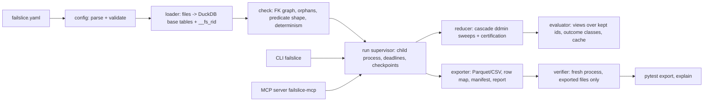

# FailSlice design (v1)

Status: agreed design after Phase 1 (Claude draft + independent Codex design + two debate
rounds; history in the git-ignored `.handoff/phase1-*`). Decisions are recorded as ADRs in
[`docs/decisions/`](decisions/). This document describes what v1 *will* do; nothing here is
implemented yet.

## 1. Problem statement

Input: tables (CSV / Parquet, optionally an existing `.duckdb` file opened read-only),
declared single-column foreign keys, and a failure predicate written in DuckDB SQL.
Output: a much smaller set of rows that still makes the predicate TRUE, with no new
dangling references, independently replayed in a fresh process, plus a manifest, a
Markdown report and a pytest regression test.

FailSlice applies known techniques (delta debugging / ddmin, FK-aware subsetting). It never
claims global minimality and never claims to find a root cause.

## 2. Architecture



Package layout (`src/failslice/`):

| Module | Responsibility |
|---|---|
| `config.py` | YAML schema (pydantic models), path checks against the allowed root, FK graph + cycle detection |
| `loader.py` | Load files into DuckDB schema `__fs_base`, assign `__fs_rid`, record resolved schema and input hashes |
| `predicate.py` | Predicate forms, sqlglot validation, execution, outcome classification, result/error signatures |
| `evaluator.py` | `Evaluator` protocol; in-process DuckDB evaluator (views over kept-id tables, cascade repair, cache, timeout watchdog) |
| `reducer.py` | Cascade ddmin sweeps, fixed point, certification pass, budgets, progress events |
| `supervisor.py` | Child-process runner, checkpoints, hard deadlines, evaluation-budget accounting |
| `export.py`, `manifest.py`, `report.py` | Artifacts |
| `verify.py` | Independent replay (`python -m failslice.verify` in a fresh process) |
| `pytest_export.py`, `explain.py` | Test generation, surviving-row explanation |
| `inference.py` | PK/FK *suggestions* for `init` / `suggest_relationships` |
| `cli.py` | Typer app (`failslice`) |
| `mcp_server.py` | MCP server (`failslice-mcp`) |
| `api.py` / `__init__.py` | Small public API |

Public API (implemented in Phase 2; `export_pytest` and `explain` follow in Phase 3):

```python
project = failslice.load_project("failslice.yaml")
project = project.with_settings(seed=1, max_evals=2000)  # budgets and seed live in settings
report = failslice.check(project)  # CheckReport: tables, FK orphans, determinism
result = failslice.reduce(project, isolate=True, on_progress=print)  # ReductionResult
result.minimality_label  # "1-minimal (verified)" or "reduced, minimality not verified"
vrep = failslice.verify(result.run_dir)  # VerificationReport (fresh process)
```

## 3. Configuration

```yaml
version: 1
tables:
  customers: { path: data/customers.csv, primary_key: id }
  orders:    { path: data/orders.parquet, primary_key: order_id }
  lines:     { path: data/lines.parquet }
foreign_keys:
  - orders.customer_id -> customers.id
  - lines.order_id -> orders.order_id
predicate:
  sql: |
    SELECT sum(l.amount) <> (SELECT sum(amount) FROM lines)
    FROM lines l JOIN orders o USING (order_id)
settings: { seed: 0, threads: 1, eval_timeout_s: 30, max_evals: 5000,
            wall_clock_s: 900, minimality: true }
```

- Paths are resolved relative to the config file and must lie inside the allowed root
  (default: the config's directory; `--root` to widen). Symlinks are resolved before the check.
- Primary keys are optional and informational (used by `explain`, `init` and duplicate
  diagnostics); they are **not** enforced, because duplicate keys are often the bug.
- FKs: single column, `child.col -> parent.col`, graph must be acyclic (cycle = config
  error that names the cycle). Self-references are cycles and are rejected in v1. The
  referenced column need not be unique.
- Config format and CLI framework: [ADR 0006](decisions/0006-interfaces-and-dependencies.md).

## 4. Data model

- Each table is loaded into `__fs_base.<name>` with an extra `__fs_rid BIGINT` =
  0..n-1 in file read order (`preserve_insertion_order=true`). Row ids are stable for a
  given input file (input hash is recorded); a re-load of the same files gives the same ids.
- The **resolved schema** (column names and DuckDB types after CSV sniffing) is recorded and
  reused for replay, so types do not drift when a 1-row CSV is re-sniffed.
- A **configuration** `K = (K_t)` is a set of kept row ids per table.
- **Support:** a kept child row `r` is supported under FK edge `e` iff `r.col IS NULL`, or
  some kept parent row has `p.col = r.col` (DuckDB `=` semantics), or `(e, r)` is an
  **input orphan exemption** (r had no matching parent in the full input).
- **Intact:** every kept child row is supported under every FK edge.

Integrity guarantee (relative, ADR 0002): *reduction never creates a dangling reference the
input did not have.* Input orphans are reported by `check`, keep their exemption only for the
edge on which they were orphaned, and are still removable.

## 5. FK-consistent reduction (ADR 0002)

**Repair = cascade = greatest intact subset.** Intact configurations are closed under union,
so every row set `S` has a unique greatest intact subset `G(S)`. It is computed in one pass
over tables in topological order (parents first): keep the candidate rows of a table that
are supported by the already-final parent tables. Deleting a row set `D` from `K` therefore
yields `C(K, D) = G(K \ D)`: deleting a parent row also deletes the children that lose their
last supporting parent, transitively; deleting one of several duplicate parent rows deletes
nothing else.

Upward closure was rejected: with non-unique parent keys a child needs *one of* several
parents, so a smallest intact superset is not unique, and re-adding all matches over-keeps.

**Search.**

1. Units are the kept row ids of one table, in a seeded permutation (`hash(rid, seed)`)
   fixed at the start of the run. Cascaded rows are consequences, not units.
2. A **sweep** visits tables in topological order (parents first, so early deletions
   cascade large chunks). For each table:
   - try deleting the whole table (empty tables are allowed);
   - otherwise run ddmin over its ids: partition into `g` balanced blocks; test
     complements first (delete one block), then subsets (keep one block of this table);
     complement success → `g = max(g-1, 2)`; subset success → `g = 2`; no success →
     `g = min(2g, n)`; stop after singleton granularity fails.
   - every candidate goes through `C`; **only a TRUE outcome is accepted**, and an
     accepted candidate commits the repaired configuration for all tables.
3. Sweeps repeat until a whole sweep accepts nothing (fixed point) or a budget stops.

Termination: every acceptance strictly decreases the total number of kept rows, so there
are at most `N` acceptances; each unsuccessful ddmin run has finite granularity steps;
budgets bound everything.

Non-monotone predicates (`NOT IN`, anti-joins, `COUNT = k`) are supported: outcomes are
never inferred from subsets or supersets; every accepted configuration was evaluated TRUE.
Cascades make blocks overlap, so classic ddmin guarantees are not inherited — hence the
explicit certification pass.

**Cost.** Worst case per ddmin run is `O(n_t^2)` evaluations. No distribution-free expected
bound exists for arbitrary predicates; for small fixed witnesses we expect roughly 100-300
reduction evaluations on ~1M rows over 3 tables. This is an estimate to be measured by the
benchmarks (Phase 5), not a promise.

## 6. 1-minimality (ADR 0002)

Definition: `K` is **1-minimal under cascade deletion** iff `P(K) = TRUE` and for every
kept row `r`, `P(C(K, {r})) != TRUE`.

Certification pass (optional, on by default): for every kept row, evaluate `C(K, {r})`
fresh (no cache). If any is TRUE, accept it and restart certification over all tables from
scratch. Report **"1-minimal (verified)"** only after a complete sweep in which every single
deletion was evaluated and none was TRUE. Any ERROR, TIMEOUT, budget stop or deadline in this
pass ⇒ **"reduced, minimality not verified"**. This is local minimality under the stated
deletion rule, never minimum cardinality.

## 7. Predicate semantics (ADR 0003)

The predicate is one read-only `SELECT` (CTEs allowed) referencing configured tables by
unqualified name. Three forms:

| Form | TRUE | FALSE | ERROR |
|---|---|---|---|
| `sql:` boolean SELECT | exactly 1 row × 1 BOOLEAN column, value TRUE | value FALSE or NULL (NULL only after the BOOLEAN type check) | 0 or >1 rows/columns, non-BOOLEAN type, any exception |
| `expect:` query + expected (inline value or file) | query completes and its result **differs** from expected (or `equals` if configured) | the opposite | query exception, expectation load/compare failure |
| `raises:` query + `match` regex (+ optional `error_class`) | the query raises a DuckDB error whose class and message match (regex search, explicit flags) | the query completes | a non-matching error (different failure), framework error |

- The result is fully fetched before classification (errors can surface during fetch).
- Expectation comparison: exact typed bag equality (duplicates count, NULL = NULL, columns
  by position, row order ignored unless `ordered: true`); optional absolute
  `float_tolerance`. A scalar expectation requires a 1×1 result.
- **TIMEOUT** overrides all forms. Only TRUE counts as "still failing". ERROR outcomes
  are counted per error class so slippage (a different failure) is visible in the report.
- Every outcome carries a **signature**: the boolean, a hash of the canonical result, or
  `(error class, message)`.

**Determinism check** (in `check` and before every `reduce`): evaluate on the full data
twice through plain views over the base tables (original columns only, no row-id filter)
and twice through the reduction view layer with all rows kept, uncached, with `threads=1`.
Both paths expose exactly the original columns, so `SELECT *` and `NATURAL JOIN` behave the
same.
All four must be TRUE with identical signatures; otherwise refuse
(`--allow-nondeterministic` downgrades to a loud warning and disables the 1-minimal claim).
Volatile functions (`random()`, `now()`, `uuid()`, ...) in the predicate are rejected.
Two matching runs are a screen, not proof; the independent replay is the real check.

## 8. Evaluator and materialization (ADR 0005)

- Base tables live in `__fs_base`; the names the predicate uses are views in `main` that
  select the original columns from base via a semi-join with a one-column kept-id table.
  Internal columns are hidden.
- Reducer state stays inside DuckDB: `cur_<t>(rid, pos)` with the seeded order; a candidate
  is described by excluded position ranges; cascade repair runs as SQL into `cand_<t>` in
  topological order. No base data is copied per evaluation. Candidates run in a
  transaction that is rolled back on rejection; the connection is rebuilt if rollback fails.
- Measured on DuckDB 2.0 (200k + 800k rows, join+aggregate predicate, 8 ms on raw tables):
  pushing Python id lists per evaluation cost 430 ms at 500k ids; the in-DuckDB range
  approach cost 110-180 ms at full scale and ~7 ms on tiny sets. Phase 2 re-measures this
  in the benchmark.
- Evaluation uses `threads=1` by default. After loading: `allowed_directories = [<run dir>]`,
  then `enable_external_access=false` (DuckDB refuses to re-enable it on a running database).
  Export therefore writes Parquet/CSV with `COPY` into the run directory only (verified on
  DuckDB 2.0: writes inside the allowed directory succeed, writes elsewhere and
  `read_csv('/etc/passwd')` raise `PermissionException`). The run directory holds only
  FailSlice's own outputs, and table functions are rejected in predicates anyway.

## 9. Cache (ADR 0004)

- In-run cache of **non-TRUE** outcomes only (FALSE, ERROR), keyed by the namespace
  `(engine version, fingerprint algorithm version, input hashes, schema, FKs, exact predicate
  spec incl. expectation and regex, comparison rules, settings)` plus a per-table fingerprint
  `(count, sum(hash(rid))::HUGEINT, bit_xor(hash(rid)))` of the repaired configuration
  (~2 ms vs ~135 ms for an exact sha256 at 800k ids).
- A collision can only make the search skip a deletion (a search hint, not evidence). TRUE
  is never cached; every accepted configuration was freshly evaluated TRUE. Determinism
  check, certification and replay bypass the cache. TIMEOUT is never cached.

## 10. Budgets, supervisor and timeouts (ADR 0005)

- Budgets: `max_evals`, `wall_clock_s`, `eval_timeout_s`. The wall-clock budget covers the
  whole run including export and replay; time is reserved for those stages.
- Per-evaluation timeout is **cooperative**: a watchdog calls `con.interrupt()`; DuckDB stops
  at its next interruption check. The watchdog is joined before the connection is reused.
- **Run supervisor:** CLI and MCP (and `reduce(isolate=True)`) run the reduction in a child
  process. The parent grants evaluation tokens (so counts stay exact even if the child dies),
  receives progress events, and kills the child if the wall clock is exceeded or one
  evaluation runs past `eval_timeout_s + grace`.
- **Checkpoints:** written atomically (temp + rename) after the full data passes `check`
  (initial checkpoint) and after every acceptance: kept ids per table, run id, input
  identity. If the child is killed, the parent reloads the original files (hashes must
  match, same row ids), exports the checkpoint and replays it under the remaining deadline.
  Killed before the initial checkpoint ⇒ "no confirmed candidate". If replay cannot finish
  in time ⇒ "unverified candidate".
- The library default is in-process (`isolate=False`) with cooperative timeouts, as documented.

## 11. Verification

`failslice verify` / the final step of `reduce` starts a fresh Python process that builds a
new DuckDB only from the exported Parquet files with the recorded schema, disables external
access, runs the predicate (uncached) and checks integrity: every non-NULL FK value has a
kept parent, except rows with a recorded `(edge, original row id)` orphan exemption (from
`orphans.parquet`; every other dangling reference is an integrity failure). The result statuses are:

- `verified`: predicate TRUE in replay and integrity holds;
- `replay-failed`: predicate not TRUE in replay (reported with outcome and signature —
  typically order-dependence or type drift; never hidden);
- `integrity-failed`;
- `unverified` (deadline).

## 12. Artifacts

Run directory `.failslice/runs/<run-id>/`:

- `tables/<t>.parquet` (source of truth) and `csv/<t>.csv` (convenience)
- `rowmap.parquet`: table, output row index, original `__fs_rid`
- `orphans.parquet`: the input-orphan exemptions that survive in the output, as
  `(fk edge, child table, output row index, original __fs_rid)`; replay needs only this file
  and `rowmap.parquet`, never the original data
- `expected/`: a snapshot of any expectation file used by an `expect:` predicate (hash in
  the manifest); the expectation is read once at config time, so editing the original file
  during a run cannot change the oracle
- `manifest.json`: input/output hashes, row counts before/after, predicate, config, engine
  versions, seed, evaluation counts by outcome, elapsed time, stop reason, verification
  status, `minimality: "verified" | "not verified"`
- `report.md`; `checkpoint.json`
- `export-test` writes `test_<name>.py` plus fixture Parquet (and the expectation snapshot, if any); polarity flag
  `--expect fails` (default, the test asserts the failure) or `--expect passes` (regression
  test for after the fix).

## 13. Safety model (ADR 0007)

Threat: a predicate or config (possibly written by an AI agent through MCP) that reads or
writes files, escapes the allowed root, or mutates state.

- Paths: resolved (incl. symlinks) and required to be inside the allowed root.
- Predicates: parsed with sqlglot (DuckDB dialect) to exactly one `SELECT` / `WITH ... SELECT`;
  rejected: DDL/DML, `COPY`, `ATTACH`, `INSTALL`/`LOAD`, `PRAGMA`, `SET`, `CALL`, table
  functions (`read_csv`, `read_parquet`, `glob`, ...), schema-qualified references,
  references other than configured tables and CTE names, volatile functions.
- Engine: files are loaded first, then `enable_external_access=false`; `.duckdb` inputs are
  attached read-only; only physical base tables may be referenced (views, macros and
  tables whose name resolves to a view are rejected via `duckdb_views()` before any data is
  read, because a view can read files outside the root); then they are copied into
  `__fs_base` and access is disabled.
- Defense in depth: sqlglot validation can miss DuckDB-specific syntax, so the disabled
  external access is the actual barrier for file access.
- Not in scope: resource exhaustion beyond the budgets; malicious DuckDB bugs.

## 14. CLI and MCP (overview; details in Phases 3-4)

CLI (Typer): `init` (scaffold + PK/FK **suggestions**), `check`, `reduce`, `verify`,
`export-test`, `explain`; rich progress (shrink ratio, evaluations, elapsed).

MCP (`mcp` 2.x, `MCPServer`): tools `inspect_dataset`, `suggest_relationships`,
`check_predicate`, `reduce_failure` (progress notifications via `ctx.report_progress`,
budgets), `verify_reproducer`, `explain_reproducer`, `export_pytest`, all with structured
output (typed return models); resources for the latest manifest, report and reduced-table
previews; one prompt "debug this data bug".

## 15. Test plan

- Unit tests per module; ≥ 90% coverage on the core engine (config, loader, predicate,
  evaluator, reducer, supervisor, verify).
- Hypothesis property tests on random small DAG schemas (incl. duplicate parent keys, NULL
  FKs, input orphans) with planted multi-row bugs: output predicate TRUE; integrity holds;
  output ⊆ input; same seed ⇒ same output for runs that stop without any time-based event
  (no wall-clock stop, no TIMEOUT outcome; time-based stops depend on machine load and are
  reported as such); whenever "1-minimal (verified)" is reported, a
  brute-force singleton check agrees.
- `G` (cascade repair) tested against a pure-Python reference implementation.
- Brute-force oracle on tiny datasets (all intact subsets) to compare result size with the
  true minimum; reported, not asserted as equal.
- Outcome-classification tests for every row of the table in §7; determinism-check tests.
- Supervisor tests: kill mid-run, recovery from checkpoint, deadline covering replay.
- Safety tests: rejected predicate catalogue, path escapes, external access disabled.
- Golden tests for manifest/report/pytest output; CLI tests; MCP tests with the in-memory
  client.
